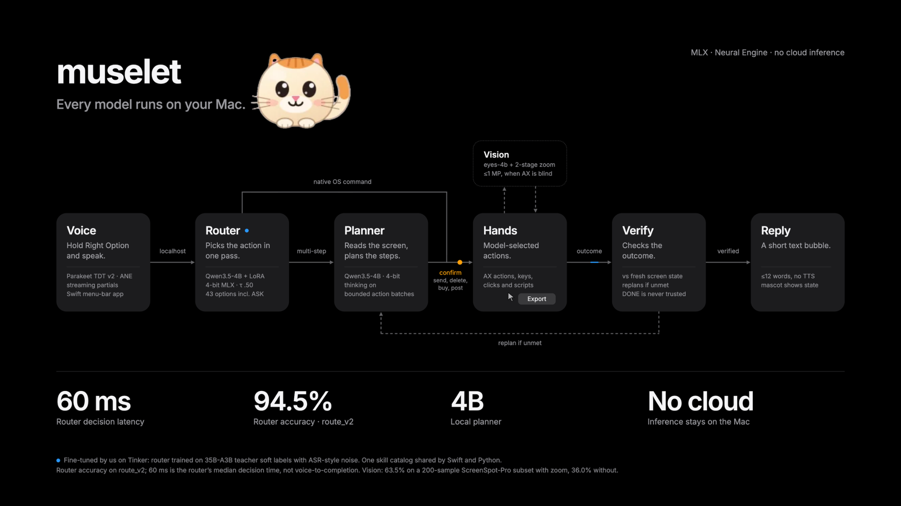

<p align="center"></p>

# muselet

**an on-device voice agent for macOS. say it, and your mac does it**

muselet is a voice agent that actually operates macOS for you, and everything runs on-device on Apple Silicon. No cloud models, no screen uploads. Hold **Right Option**, talk, and a little mascot gets it done while a ghost cursor shows you where it's clicking.

Built at Cal Hacks 13.0.

## What it can do

- **Instant stuff**: "volume 30", "dark mode", "turn off Wi-Fi", "open Downloads". The router decides in a single forward pass (~60 ms), and the first action lands ~190 ms after you let go of the key.
- **Apps, used like a person would**: timers, reminders, notes, messages, email drafts. It reads the accessibility tree, acts, checks the result, and stops as soon as the goal is visible on screen.
- **The web, in your own browser**: "play some jazz on YouTube", "add chicken to my cart". It uses the site's own search box in your current tab and never checks out.
- **Finance, offline**: "prep me for my meeting with the Hendersons" builds a client brief from Calendar, Finder, Numbers and Notes. "Reconcile my receipts" OCRs the receipts on-device and flags any mismatches. All math is done by deterministic `Decimal` code, never by the model.
- **Premiere Pro**: cut, add markers, export, set clip speed and duration.
- **Safe by default**: it *asks* when a request is ambiguous, *confirms* before anything that sends, deletes, buys or posts, and *refuses* destructive requests.

## How it works

<p align="center"></p>


```
Right Option -> Parakeet STT (Neural Engine) -> brain (Python + MLX, ws://127.0.0.1:8765)
   System 1: trained 4B router, one forward pass -> skill | planner | ask | refuse
   System 2: planner reads the AX tree -> action DSL (<= 5 steps, each with an `expect` check)
   grounder (eyes-4b + 2-stage zoom) only when the AX tree is blind
-> HandsKit (Swift): native skill > AX action > keys > pixel click -> verify -> mascot bubble
```

What we built:
- **Router**: Qwen3.5-4B with a LoRA we trained on Tinker, using soft labels from a 35B teacher and decontaminated against competitor benchmarks. It scores .945 on route_v2 and decides in ~60 ms.
- **Planner**: a 4B LoRA we trained on Tinker. It scores .85 mean pass rate across our three held-out sets at ~0.3 s per step. Qwen3.6-35B-A3B takes over for web pages and screens the accessibility tree can't read.
- **HandsKit**: a Swift layer that drives the Mac through the Accessibility API, with fused act-and-observe calls, `expect` predicates, OCR and the ghost cursor.
- **Two-stage zoom grounding**: takes eyes-4b on ScreenSpot-Pro from 36% to 63.5% at 1 MP.
- **Strict evals**: graders check the final state; every live failure becomes a regression test. The live suite passes 19/22 single-step tasks.

Numbers, along with their sources and caveats, are in [`pitch/claims.md`](pitch/claims.md) and [`docs/REPORT.md`](docs/REPORT.md).

## Run it

You need an Apple Silicon Mac, Xcode, and [uv](https://github.com/astral-sh/uv).

```sh
uv sync --project ml
bash app/scripts/build_app.sh && open app/build/Muselet.app   # grant Accessibility, Mic, Screen Recording
tools/serve_brain.sh                                          # starts the brain on :8765
```

Then hold Right Option and say something. Every model choice (router, planner, grounder) can be swapped with an env var; see `tools/serve_brain.sh`.

Tests:
```sh
uv run --project ml python -m pytest ml/tests -q
uv run --project ml python -m pytest bench/tests -q
(cd app && swift test)
```

## Repo map

| Path | What's there |
|---|---|
| `app/` | Swift menu-bar app (voice, mascot, overlay) + HandsKit |
| `ml/` | the brain: orchestrator, router, planner, grounder, finance tools |
| `skills/catalog.json` | the native skill catalog, shared by Swift and Python |
| `training/` | Tinker training pipeline for the router and planner |
| `evals/`, `bench/` | eval suites, the live runner, HobbyLM / DeskMind harnesses |
| `pitch/`, `docs/` | demo script, claims registry, full report |

For deeper detail, see [`AGENTS.md`](AGENTS.md) (architecture, protocol, design rules) and [`docs/HANDOFF.md`](docs/HANDOFF.md).
