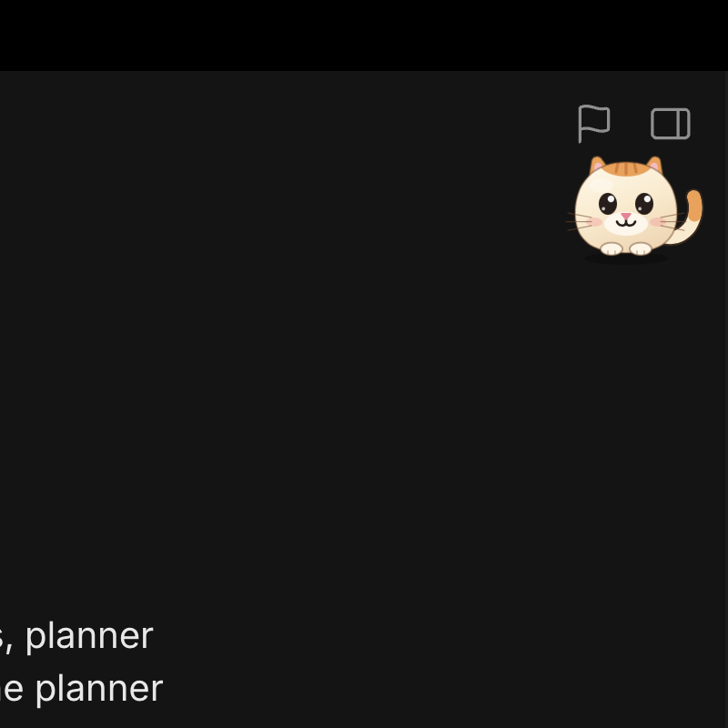

<p align="center"></p>

# Muselet

**Hold a key, say it, it's done. On your Mac, offline.**

Muselet is a voice agent that actually operates macOS for you, and everything runs on-device on Apple Silicon. No cloud models, no screen uploads. Hold **Right Option**, talk, and a little mascot gets it done while a ghost cursor shows you where it's clicking.

Built at Cal Hacks 13.0.

## What it can do

- **Instant stuff**: "volume 30", "dark mode", "turn off Wi-Fi", "open Downloads". The router decides in a single forward pass (~60 ms), and the first action lands ~190 ms after you let go of the key.
- **Apps, used like a person would**: timers, reminders, notes, messages, email drafts. It reads the accessibility tree, acts, checks the result, and stops as soon as the goal is visible on screen.
- **The web, in your own browser**: "play some jazz on YouTube", "add chicken to my cart". It uses the site's own search box in your current tab and never checks out.
- **Finance & analysis tasks** ("prep me for my meeting with the Hendersons", "reconcile my receipts") are AI-planned through generic live-state tools — Calendar, Finder, Numbers, Notes driven via Accessibility plus on-device OCR — like every other app task. The earlier deterministic finance/advisor workflow engines were removed; there is no finance-specific script engine, and end-to-end validation of these task classes is still pending.
- **Premiere Pro**: timeline focus, clip selection, speed/duration and export through the same generic UI tools — no Premiere-specific workflow engine. Live editing reliability is still being validated (the regression suite is hermetic, not a live benchmark).
- **Safe by default**: it *asks* when a request is ambiguous, *confirms* before anything that sends, deletes, buys or posts, and *refuses* destructive requests.

## How it works

```
Right Option -> Parakeet STT (Neural Engine) -> brain (Python + MLX, ws://127.0.0.1:8765)
   System 1: trained 4B router, one forward pass -> skill | planner | ask | refuse
   System 2: planner reads the AX tree -> native tool calls, one tool per turn
     (current demo build; an action-DSL mode with <= 5 steps per turn is retained as an alternative)
   grounder (eyes-4b + 2-stage zoom) only when the AX tree is blind
-> HandsKit (Swift): native skill > AX action > keys > pixel click -> verify -> mascot bubble
```

What we built:
- **Router**: Qwen3.5-4B with a LoRA we trained on Tinker, using soft labels from a 35B teacher and decontaminated against competitor benchmarks. It scores .945 on route_v2 and decides in ~60 ms.
- **Planner**: the current demo build runs the base Qwen3.5-4B in native-tools mode — one tool call per turn, fresh observations after actions, and independent completion checks (not a guarantee of success). A Tinker-trained 4B LoRA in DSL mode (.85 mean pass across three held-out sets, ~0.3 s/step) and a Qwen3.6-35B-A3B blind/page planner remain selectable alternatives; those numbers belong to the named offline configs in [`docs/REPORT.md`](docs/REPORT.md), not the live build.
- **HandsKit**: a Swift layer that drives the Mac through the Accessibility API, with fused act-and-observe calls, `expect` predicates, OCR and the ghost cursor.
- **Two-stage zoom grounding**: takes eyes-4b from 36% to 63.5% on a paired 200-sample ScreenSpot-Pro subset at 1 MP.
- **Strict evals**: graders check the final state; live failures become regression tests. The live suite passed 19/22 single-step tasks on the earlier it2-router/no-think 4B configuration — a historical named-config result, not a current-build guarantee.

Numbers, along with their sources and caveats, are in [`pitch/claims.md`](pitch/claims.md) and [`docs/REPORT.md`](docs/REPORT.md). Each metric names the configuration it was measured on; the currently deployed on-device build overrides the script defaults with a base-4B native-tools planner ([details](docs/native-ui-planner.md)), so the historical LoRA/35B timings above are not measurements of that deployment.

## Run it

You need an Apple Silicon Mac, Xcode, and [uv](https://github.com/astral-sh/uv).

```sh
uv sync --project ml
bash app/scripts/build_app.sh && open app/build/Muselet.app   # grant Accessibility, Mic, Screen Recording
tools/serve_brain.sh                                          # starts the brain on :8765
```

Then hold Right Option and say something. Every model choice (router, planner, grounder) can be swapped with an env var; see `tools/serve_brain.sh`.

Tests:
```sh
uv run --project ml python -m pytest ml/tests -q
uv run --project ml python -m pytest bench/tests -q
xcodebuildmcp swift-package test --package-path app
```

The latest full Python-suite attempt was incomplete and showed failures; it is not a green full-suite result.
Passed targeted checks and the broader verification limitation are recorded in [`docs/REPORT.md`](docs/REPORT.md#0a-reliability-coverage-2026-10-25).

## Repo map

| Path | What's there |
|---|---|
| `app/` | Swift menu-bar app (voice, mascot, overlay) + HandsKit |
| `ml/` | the brain: orchestrator, router, planner, grounder |
| `skills/catalog.json` | the native skill catalog, shared by Swift and Python |
| `training/` | Tinker training pipeline for the router and planner |
| `evals/`, `bench/` | eval suites, the live runner, HobbyLM / DeskMind harnesses |
| `pitch/`, `docs/` | demo script, claims registry, full report |

For deeper detail, see [`AGENTS.md`](AGENTS.md) (architecture, protocol, design rules) and [`docs/HANDOFF.md`](docs/HANDOFF.md).
