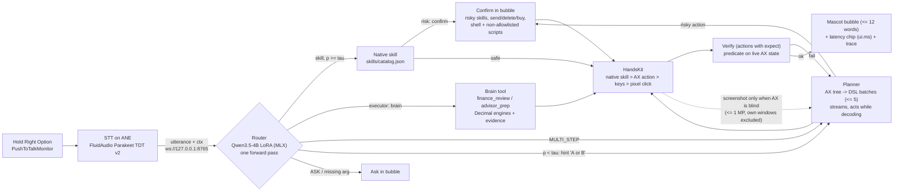

# Architecture

Code paths for every box are in `claims.md` §2. Numbers are placeholders from `claims.md` §1.

Everything above runs on the Mac. The only sockets are loopback (brain `:8765`, Premiere bridge `:8766`).
Models load with `local_files_only=True`.
Gates are scoped, not universal: `verify` runs only for actions with an `expect`; planner `done` is accepted
only after a passing `expect` or a fresh observation (no harness-side goal check); confirm covers the cases in `claims.md` §2.

## Latency budget (instant command, release -> first action)

| Stage | Budget | Measured (p50 / p95) | Source |
|---|---|---|---|
| STT final transcript | target TBD(lead) | TBD(live latency run) | panel "Last release → text" |
| Router (cached prefix + suffix) | ~55 ms (target) | 52 ms (r2) / TBD(route p95, it2) | `route_ms` |
| ARGS extraction | target TBD(lead) | 97 ms (r2) | `args_ms` |
| Ghost cursor lead | 120-220 ms (code constant) | n/a | `GhostCursor.swift:69` |
| HandsKit act + settle | target TBD(lead) | TBD(live latency run) | `act_ms`, `settle_ms` in traces |
| **Release -> first action** | target TBD(lead) | 193 ms p50 / 812 ms p95 (live suite, `runs/bench/live/20261024T161427Z`) | `release_to_first_action_ms` |

Multi-step: planner Qwen3.5-4B-4bit at 83 tok/s (earlier tuned config; TTFT 184.6 ms p50 on v2-holdout with k=1 retrieval, `cloud/handoff/notes/retrieval_eval.md`); first action is executed as soon as its
line is decoded, so release -> first action is STT + route + planner prefill + one line, not a whole batch.
