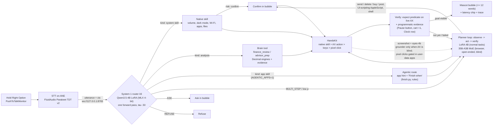

# Architecture (what ships Sun Oct 25)

Code paths for every box are in `claims.md` §2 and §2b. Serving flags: `tools/serve_brain.sh`, `AGENTS.md`
"Current serving configuration".

Everything above runs on the Mac. The only sockets are loopback (brain `:8765`, Premiere bridge `:8766`); models load
with `local_files_only=True`. The internet is used only by tasks that need a website (YouTube, Gmail, Amazon).

Gates are scoped, not universal: `verify` runs for actions with an `expect`; planner `done` is accepted only after a
passing `expect`, a fresh observation, or the goal's programmatic evidence; confirm covers the cases in `claims.md` §2.

## Latency (measured values only; sources in `claims.md`)

| Stage | Measured | Source |
|---|---|---|
| Router it3 route p50 | 60.4 ms | `runs/router/it3_*.json` via `evals/router_check.py` (lead) |
| ARGS extraction p50 | 97 ms (r2, earlier router) | `runs/router/r2_self_clean.json` |
| Ghost cursor lead | 120-220 ms (code constant) | `GhostCursor.swift:69` |
| Release -> first action (System 1) | 193 ms p50 / 812 ms p95 (live suite, earlier config) | `runs/bench/live/20261024T161427Z` |
| Planner step, LoRA 4B | ~0.3 s p50 | `tools/serve_brain.sh` header (lead) |
| Planner step, 35B-A3B think 512 | 6.0 s p50 (offline bench, earlier prompt) | `cloud/handoff/notes/planner_think_eval.md` @ c9a5cce |
| STT, act + settle, agentic task totals | TBD(live latency run) | traces |

Multi-step work chooses intelligence over latency (ship gate per-step p50 <= 3 s for the normal planner,
`AGENTS.md`); the 35B planner is used only where the small one is blind or the task is open-ended, and the first
action executes as soon as its line is decoded.
